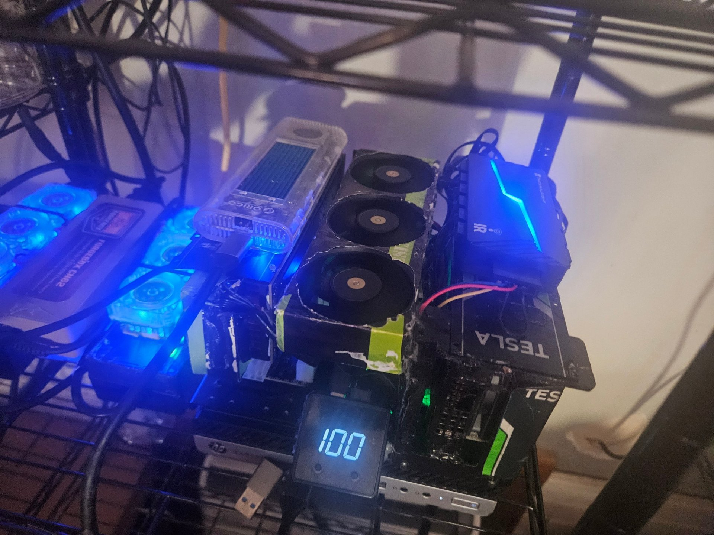
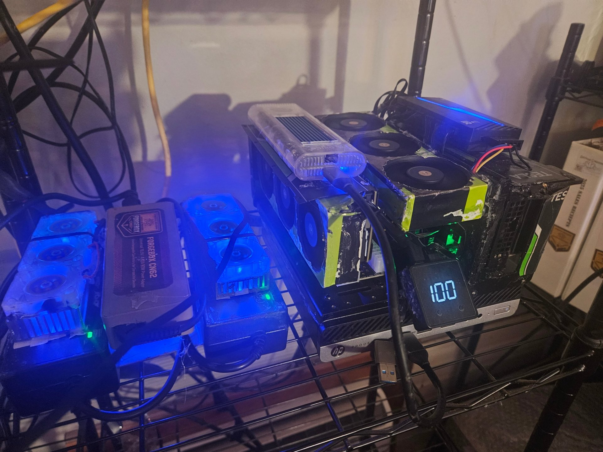
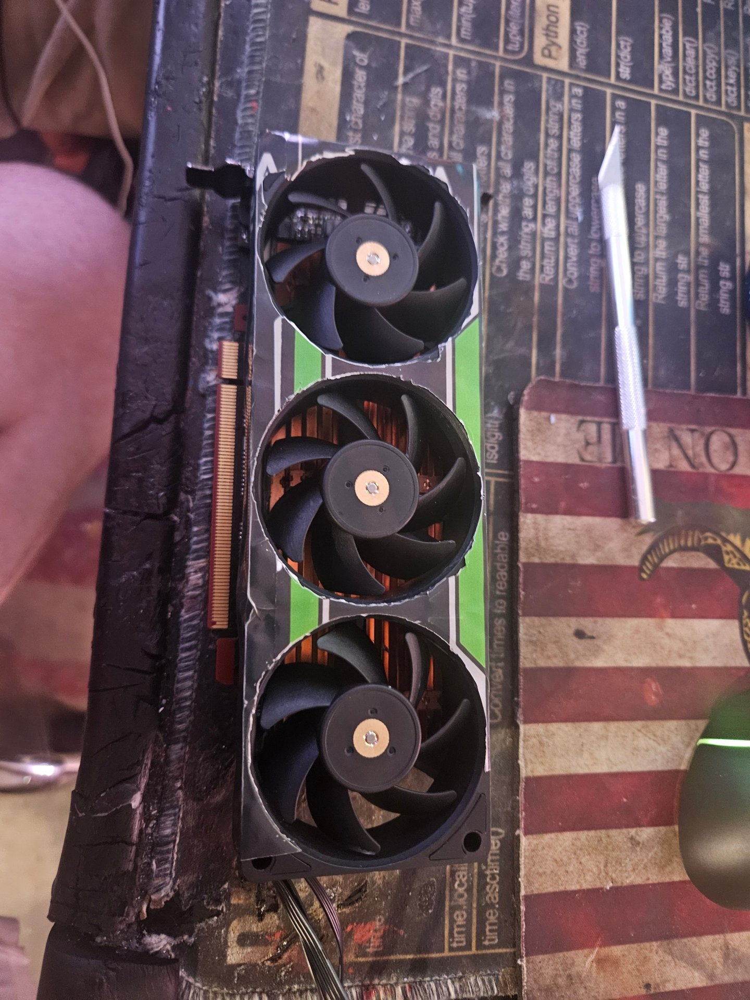
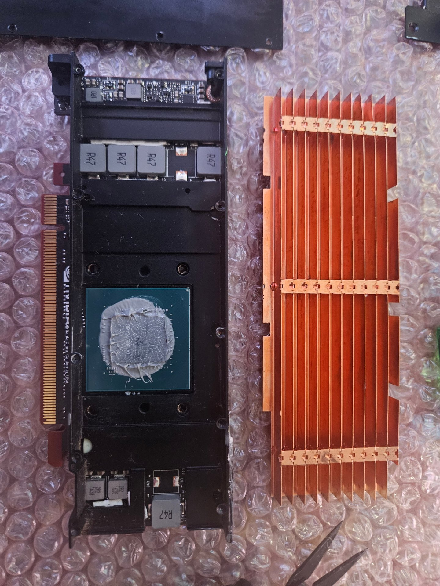
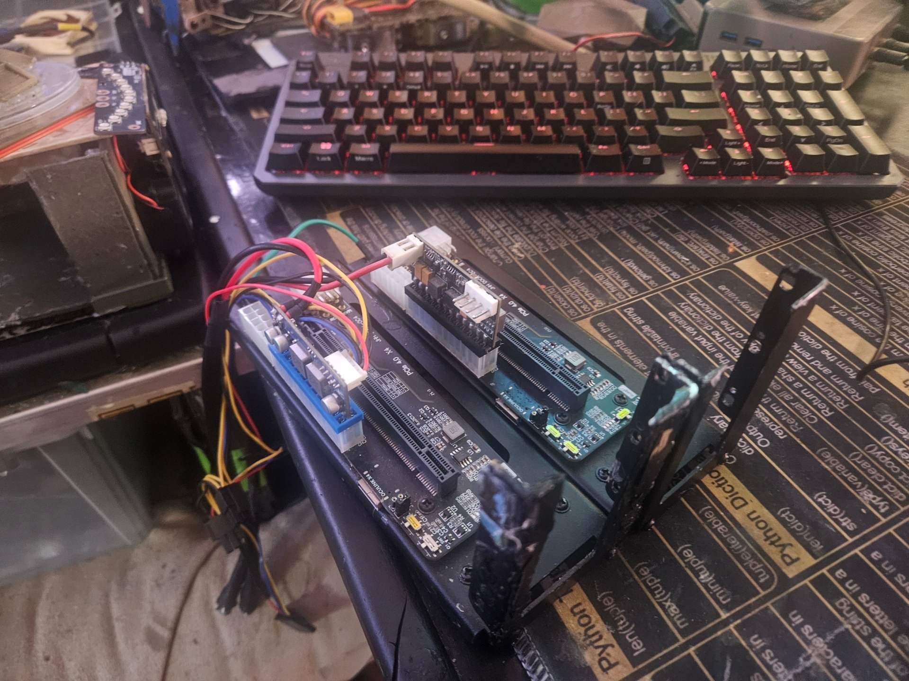

# EvE v2: Dual Tesla P4 GPU Server


**Two Tesla P4 data-center GPUs on a mini PC, for about $600.**

An **HP ProDesk 600 G5 Mini** has no PCIe slot, but it has two M.2 slots. Each one becomes an external PCIe x4 link through an **OCuLink** adapter and dock, carrying one used **NVIDIA Tesla P4** (8 GB). A hub-driven set of nine fans keeps everything cool. The result is a quiet, low-power box for local LLM inference, speech-to-text, transcoding and training experiments.



## Highlights

- **16 GB of GPU memory** across two cards, with 75 W power limit per card
- **About $600** in total, mostly used parts from eBay
- **~27.7 tokens/s** for an 8B model (4-bit) on a single P4
- **Peak 61 °C and 65 W per GPU** under sustained inference on both cards
- **Automatic fan control:** a XIAO reads GPU temperature and drives a Thermalright fan hub

## Specs

| Part | Details |
|------|---------|
| Host | HP ProDesk 600 G5 Mini, Intel Core i7-9700T (8 cores, up to 4.3 GHz), 32 GB RAM. Bought barebones on eBay, powered by a 90 W universal laptop brick |
| Storage | 2 TB PNY 2.5" SATA SSD (boot), plus a 512 GB KingSpec NX NVMe drive in a fan-cooled ORICO 40 Gbps enclosure on the USB-C port |
| GPUs | 2x NVIDIA Tesla P4 (used, eBay), 8 GB GDDR5, 2560 CUDA cores, compute capability 6.1 |
| GPU link | Both M.2 slots carry an M.2 → OCuLink adapter feeding a JHH OCuLink PCIe 4.0 x4 dock, one per GPU. Both cards link at PCIe 3.0 x4 |
| GPU power | One 120 W Pico PSU per dock, both fed from a single 12 V 300 W supply |
| Cooling | Copper-fin heatsink and 3x 60 mm fans in a cut-out shroud on each GPU, plus 3 more fans on the modded ProDesk case, all on a Thermalright 12-port hub |
| Software | Ubuntu 26.04.1 LTS, NVIDIA driver 580.178.04, CUDA 13.0, Docker with the NVIDIA Container Toolkit |

## Gallery

| | |
|---|---|
|  |  |
| The full stack on the shelf | A P4 with its three-fan shroud |
|  |  |
| Stock heatsink off, copper-fin heatsink alongside | OCuLink docks with Pico PSUs |

All photos with captions: [hardware/photos](hardware/photos/README.md).

## How it fits together

```
                   ┌──────────────── HP ProDesk 600 G5 Mini ────────────────┐
                   │  M.2 slot 1 ──► M.2→OCuLink ──► JHH dock ──► Tesla P4  │
 90 W brick ──────►│  M.2 slot 2 ──► M.2→OCuLink ──► JHH dock ──► Tesla P4  │
                   │  USB-C ──► ORICO enclosure (NVMe)                      │
                   └────────────────────────────────────────────────────────┘
 12 V 300 W supply ──► 2x 120 W Pico PSU ──► docks / GPUs
 XIAO (reads GPU temps) ──► Thermalright 12-port hub ──► 9x 60 mm fans
```

## Documentation

| Topic | Page |
|-------|------|
| Parts list and cost | [Bill of materials](docs/bom.md) |
| M.2 → OCuLink → GPU link, measured link widths | [PCIe / OCuLink](docs/pcie-oculink.md) |
| Power supplies and measured draw | [Power](docs/power.md) |
| Heatsinks, shrouds, fans and fan control | [Cooling](docs/cooling.md) |
| OS, driver, CUDA, Docker, services | [Software setup](docs/software-setup.md) |
| LLM inference results, temperatures, power | [Benchmarks](docs/benchmarks.md) |
| How it was assembled | [Build log](docs/build-log.md) |
| What is planned next | [Roadmap](ROADMAP.md) |

## Why this build

- The Tesla P4 is a 75 W, passively cooled, half-height card that is very cheap used.
- A USFF mini PC has no PCIe slot, but it does have two M.2 slots. OCuLink turns each into an external x4 PCIe link.
- Pascal (compute capability 6.1) still runs current CUDA toolkits and drivers, and the P4 has no artificial NVENC concurrent-session cap.

## Safety

This build uses an external 12 V supply feeding ATX-style power modules, and bare GPU cards on a shelf. The cards are open to the air, so keep fingers, metal and liquids away. Do not run the GPUs without the fans, and use a power supply rated for the load. You build and run this at your own risk.

## License

- Code and scripts: [MIT](LICENSE)
- Documentation and photos: [CC BY-SA 4.0](LICENSE-DOCS.md)
- The Spiritual Creations name, logo and label artwork are not covered by those licenses.

Built by [Spiritual Creations](https://spiritualcreations2024.org), a veteran-owned business.
